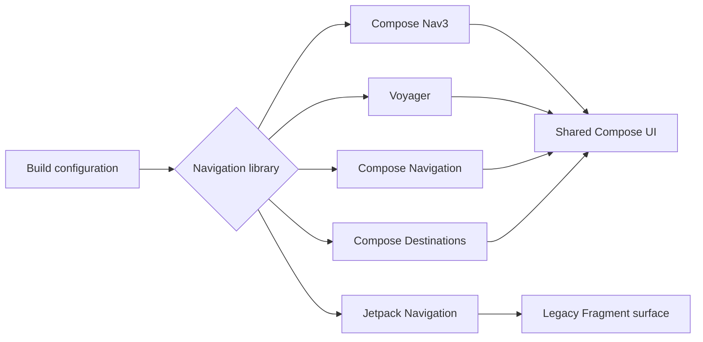

<p align="center">
  
</p>

<p align="center">
  <a href="#selected-work">Selected work</a> &nbsp;·&nbsp;
  <a href="#engineering-observatory">Observatory</a> &nbsp;·&nbsp;
  <a href="#engineering-focus">Engineering focus</a> &nbsp;·&nbsp;
  <a href="#2026--activity">Activity</a> &nbsp;·&nbsp;
  <a href="#get-in-touch">Contact</a>
</p>

I’m a **Senior Android Engineer** focused on **Compose Multiplatform**—building reusable UI libraries, comparing navigation architectures, and engineering connected-device software across supported platforms.

**Featured Compose Multiplatform work:** [HorizonBloom](https://github.com/Velord/HorizonBloom) (published visual-effects library) · [ComposeScreenExample](https://github.com/Velord/ComposeScreenExample) (architecture and UI laboratory spanning five navigation libraries).

---

## Selected work

<sub>01 / COMPOSE MULTIPLATFORM LIBRARY · ANDROID · DESKTOP · iOS</sub>

### [HorizonBloom](https://github.com/Velord/HorizonBloom)

<table>
  <tr>
    <td width="57%" valign="middle">
      <a href="https://github.com/Velord/HorizonBloom">
        
      </a>
    </td>
    <td width="43%" valign="middle">
      <strong>Atmospheric light. Pure Compose.</strong>
      <p>A configurable horizon-light scene with bloom, aurora, stars, and interactive effects. Built as a reusable Compose Multiplatform library—not a pre-rendered animation.</p>
      <p><code>Kotlin</code> <code>Compose Multiplatform</code> <code>Gradle</code></p>
      <p>
        <a href="https://github.com/Velord/HorizonBloom">Explore source ↗</a><br/>
        <a href="https://central.sonatype.com/artifact/io.github.velord/horizon-bloom/0.1.0">Maven Central · v0.1.0 ↗</a>
      </p>
    </td>
  </tr>
</table>

<sub>02 / COMPOSE MULTIPLATFORM ARCHITECTURE LAB · ANDROID · DESKTOP</sub>

### [ComposeScreenExample](https://github.com/Velord/ComposeScreenExample)

<a href="https://github.com/Velord/ComposeScreenExample">
  
</a>

A multi-module **Compose Multiplatform architecture and UI laboratory** for comparing **five navigation libraries** with shared Compose screens, multiple back stacks, and explicit platform boundaries.

**Five libraries:** **Compose Nav3** · **Voyager** · **Compose Navigation** · **Compose Destinations** · **Jetpack Navigation**.

**Android + Desktop:** Nav3, Voyager. **Android-only:** Compose Navigation, Compose Destinations, Jetpack Navigation.

**Also inside:** MVVM · Koin · Ktor · custom Compose UI.

[Explore architecture and demos ↗](https://github.com/Velord/ComposeScreenExample)

---

## Engineering focus

<table>
  <tr>
    <td width="33%" valign="top">
      <strong>01 &nbsp; Mobile systems</strong>
      <p>Android architecture, Kotlin, coroutines, app lifecycle, CI/CD and production releases.</p>
    </td>
    <td width="33%" valign="top">
      <strong>02 &nbsp; Interface engineering</strong>
      <p>Jetpack Compose, Kotlin Multiplatform, design systems and expressive, reusable UI.</p>
    </td>
    <td width="34%" valign="top">
      <strong>03 &nbsp; Connected products</strong>
      <p>BLE, device provisioning, OTA firmware delivery, telemetry and on-device intelligence.</p>
    </td>
  </tr>
</table>

---

## Engineering Observatory

<sub>INSIDE THE BUILD / 03 FIELD NOTES</sub>

Two Compose Multiplatform projects, explored from the inside: HorizonBloom’s rendered effects and release pipeline, plus ComposeScreenExample’s five-library navigation architecture.

### 01 / Effect Laboratory

**One Compose renderer. Three different atmospheres.**

The scenes below are captured from [HorizonBloom's actual Compose renderer](https://github.com/Velord/HorizonBloom), not stock artwork.

<table>
  <tr>
    <td width="33%" align="center" valign="top">
      <a href="https://github.com/Velord/HorizonBloom/blob/main/docs/media/preset-dawn.png"></a><br/><sub>01 · DAWN</sub>
    </td>
    <td width="33%" align="center" valign="top">
      <a href="https://github.com/Velord/HorizonBloom/blob/main/docs/media/preset-twilight.png"></a><br/><sub>02 · TWILIGHT</sub>
    </td>
    <td width="34%" align="center" valign="top">
      <a href="https://github.com/Velord/HorizonBloom/blob/main/docs/media/preset-aurora.png"></a><br/><sub>03 · AURORA</sub>
    </td>
  </tr>
</table>

<details>
<summary><strong>01 · Dawn</strong> — see the Compose configuration</summary>

```kotlin
HorizonBloom(config = HorizonBloomConfig.DAWN)
```

</details>
<details>
<summary><strong>02 · Twilight</strong> — see the Compose configuration</summary>

```kotlin
HorizonBloom(config = HorizonBloomConfig.TWILIGHT)
```

</details>
<details>
<summary><strong>03 · Aurora</strong> — see the Compose configuration</summary>

```kotlin
HorizonBloom(config = HorizonBloomConfig.AURORA)
```

</details>

[Full animation ↗](https://github.com/Velord/HorizonBloom/blob/main/docs/media/horizon-presets.mp4) · [Live adjustments ↗](https://github.com/Velord/HorizonBloom/blob/main/docs/media/horizon-tuning.mp4) · [Effect reference ↗](https://github.com/Velord/HorizonBloom/blob/main/docs/EFFECTS.md)

### 02 / Architecture X-Ray

**One Compose Multiplatform architecture. Five navigation libraries. Explicit module boundaries.**

| Navigation library | Supported in this project |
| --- | --- |
| **Compose Nav3** | Android + Desktop (`commonMain`) |
| **Voyager** | Android + Desktop (`commonMain`) |
| **Compose Navigation** | Android (`androidMain`) |
| **Compose Destinations** | Android (`androidMain`) |
| **Jetpack Navigation** | Android (`androidMain`, legacy Fragment navigation) |

<details>
<summary><strong>Open the navigation architecture</strong> · routing and back stacks</summary>

The [ComposeScreenExample navigation toolkit](https://github.com/Velord/ComposeScreenExample/blob/master/infrastructure/navigation/README.md) owns routes, engine adapters, navigation hosts, and separate root/tab back stacks. Feature modules express navigation intent without depending on an engine's route types.



- **Shared implementations:** Compose Nav3 and Voyager in `commonMain` (Android and Desktop).
- **Android-specific implementations:** Compose Navigation, Compose Destinations, and Jetpack Navigation in `androidMain`.
- **Responsibility:** feature modules own UI/navigation intent; infrastructure owns adapters and library-specific wiring.

[Navigation implementation ↗](https://github.com/Velord/ComposeScreenExample/tree/master/infrastructure/navigation/src)

</details>

<details>
<summary><strong>Trace module ownership</strong> · shared state and boundaries</summary>

| Area | Responsible module |
| --- | --- |
| Route and navigation-engine adapters | `:infrastructure:navigation` |
| Tab selection, bottom-navigation state and actions | `:ui:feature-bottomnavigation` |
| Dependency injection and navigation state owner | `:infrastructure:di` |
| Activity/window, platform containers and theme | App shell |

These boundaries let one UI surface use different navigation engines without leaking their implementation details into feature screens.

[Read the architecture decisions ↗](https://github.com/Velord/ComposeScreenExample/blob/master/infrastructure/navigation/README.md#ownership)

</details>

### 03 / Build Flight Recorder

**Verification history, not a fabricated uptime score.**


Generated from the public [HorizonBloom Verify workflow](https://github.com/Velord/HorizonBloom/actions/workflows/verify.yml), including the Android/Desktop and iOS job results for the latest run. Updated daily by GitHub Actions.

[Explore all workflow runs ↗](https://github.com/Velord/HorizonBloom/actions/workflows/verify.yml)

---

## 2026 · Activity


<sub>GitHub contribution activity · Automatically refreshed weekly</sub>

---

## Get in touch

**Interested in building something together?** Find me on [LinkedIn ↗](https://www.linkedin.com/in/vlad-y-26079a193/) or explore more work on [GitHub ↗](https://github.com/Velord).
