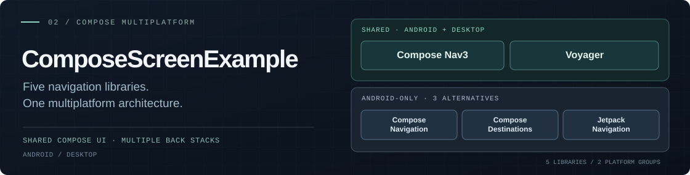
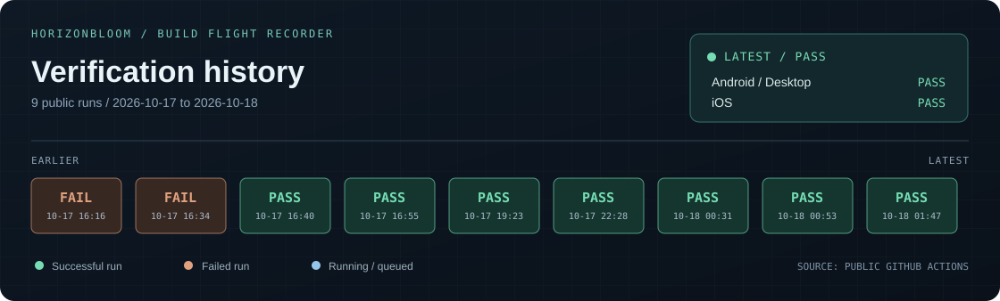
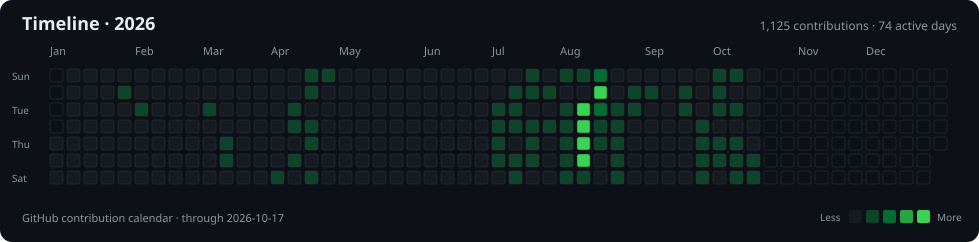
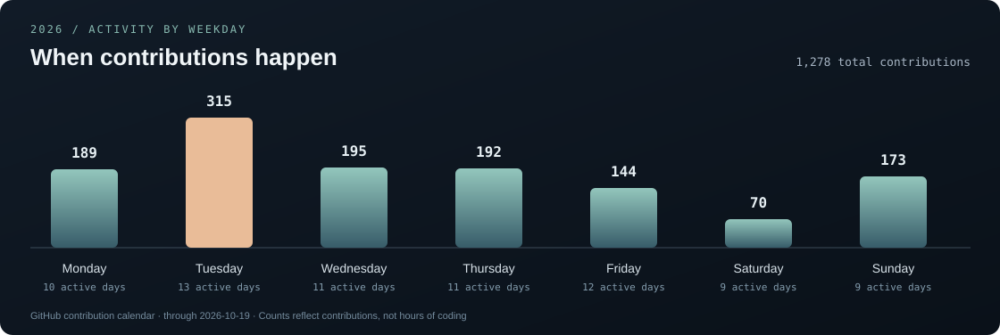

  

  <a href="#get-in-touch">Get in touch</a> &nbsp;·&nbsp;
  <a href="#selected-work">Selected work</a> &nbsp;·&nbsp;
  <a href="#engineering-focus">Engineering focus</a> &nbsp;·&nbsp;
  <a href="#build-flight-recorder">Builds</a> &nbsp;·&nbsp;
  <a href="#2026--activity">Activity</a>

I’m a **Senior Android Engineer** focused on **Compose Multiplatform**—building reusable UI libraries, comparing navigation architectures, and engineering connected-device software across supported platforms.

**Featured Compose Multiplatform work:** [HorizonBloom](https://github.com/Velord/HorizonBloom) (published visual-effects library) · [ComposeScreenExample](https://github.com/Velord/ComposeScreenExample) (architecture and UI laboratory spanning five navigation libraries).

---

## Get in touch

**Building Android or Kotlin Multiplatform software?** Connect with me or explore my open-source work.

  
  &nbsp;
  

---

## Selected work

01 / COMPOSE MULTIPLATFORM LIBRARY · ANDROID · DESKTOP · iOS

### [HorizonBloom](https://github.com/Velord/HorizonBloom)

<table>
  <tr>
    <td width="57%" valign="middle">
      
    </td>
    <td width="43%" valign="middle">
      <strong>Atmospheric light. Pure Compose.</strong>
      
A configurable horizon-light scene with bloom, aurora, stars, and interactive effects. Built as a reusable Compose Multiplatform library—not a pre-rendered animation.

      
<code>Kotlin</code> <code>Compose Multiplatform</code> <code>Gradle</code>

      

        <a href="https://github.com/Velord/HorizonBloom">Explore source ↗</a> 
        <a href="https://central.sonatype.com/artifact/io.github.velord/horizon-bloom/0.1.0">Maven Central · v0.1.0 ↗</a>
      

    </td>
  </tr>
</table>

02 / COMPOSE MULTIPLATFORM ARCHITECTURE LAB · ANDROID · DESKTOP

### [ComposeScreenExample](https://github.com/Velord/ComposeScreenExample)

A multi-module **Compose Multiplatform architecture and UI laboratory** for comparing **five navigation libraries** with shared Compose screens, multiple back stacks, and explicit platform boundaries.

**Five libraries:** **Compose Nav3** · **Voyager** · **Compose Navigation** · **Compose Destinations** · **Jetpack Navigation**.

**Android + Desktop:** Nav3, Voyager. **Android-only:** Compose Navigation, Compose Destinations, Jetpack Navigation.

**Also inside:** MVVM · Koin · Ktor · custom Compose UI.

[Explore architecture and demos ↗](https://github.com/Velord/ComposeScreenExample)

---

## Engineering focus

<table>
  <tr>
    <td width="33%" valign="top">
      <strong>01 &nbsp; Mobile systems</strong>
      
Android architecture, Kotlin, coroutines, app lifecycle, CI/CD and production releases.

    </td>
    <td width="33%" valign="top">
      <strong>02 &nbsp; Interface engineering</strong>
      
Jetpack Compose, Kotlin Multiplatform, design systems and expressive, reusable UI.

    </td>
    <td width="34%" valign="top">
      <strong>03 &nbsp; Connected products</strong>
      
BLE, device provisioning, OTA firmware delivery, telemetry and on-device intelligence.

    </td>
  </tr>
</table>

---

## Build Flight Recorder

**Verification history, not a fabricated uptime score.**

Generated from the public [HorizonBloom Verify workflow](https://github.com/Velord/HorizonBloom/actions/workflows/verify.yml), including the Android/Desktop and iOS job results for the latest run. Updated daily by GitHub Actions.

[Explore all workflow runs ↗](https://github.com/Velord/HorizonBloom/actions/workflows/verify.yml)

---

## 2026 · Activity

GitHub contribution activity · Automatically refreshed weekly

### Weekday activity

Actual 2026 GitHub contributions grouped by weekday, not coding hours · Refreshed weekly
